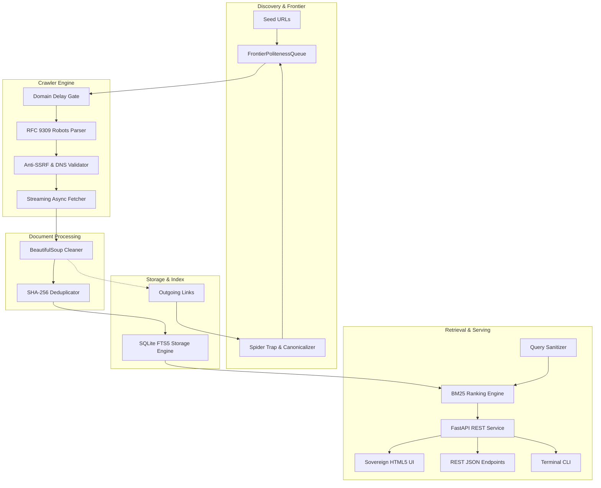

# Technical Architecture — Senda Search Engine

**Version:** 0.1.0-alpha  
**License:** GNU GPL-3.0-or-later  
**Author:** IDEH Labs <https://ideh.top>

---

## 1. System Overview

Senda is a modular, decentralized, and auditable web search engine designed for maximum privacy, reproducibility, and ethical restraint. It runs entirely on local, self-hosted hardware without dependencies on proprietary APIs, remote cloud tracking services, or external CDNs.



---

## 2. Core Subsystems

### 2.1. Network Guard (`senda.crawler.network_guard`)
The network guard acts as the foundational perimeter against Server-Side Request Forgery (SSRF) and DNS rebinding attacks:
- **IP Address Sanitization:** Prohibits RFC 1918 private networks (`10.0.0.0/8`, `172.16.0.0/12`, `192.168.0.0/16`), loopbacks (`127.0.0.0/8`, `::1`), link-local metadata addresses (`169.254.0.0/16`, `fe80::/10`), CGNAT (`100.64.0.0/10`), and test networks.
- **IPv4-Mapped IPv6 Unpacking:** Unpacks `::ffff:x.x.x.x` addresses prior to routing checks to eliminate evasion techniques.
- **DNS Resolution Pre-flight:** Every hostname is resolved to socket addresses before HTTP connections are opened.

### 2.2. Politeness & Robots.txt (`senda.crawler.robots`)
- **RFC 9309 Compliance:** Full support for `*` wildcards, `$` end-anchors, path-length specificity rules, and equal-length `Allow` preference.
- **Crawl Delay:** Adheres to domain-declared `Crawl-delay` directives, enforcing a minimum default delay (2.0 seconds).
- **In-Memory Cache:** Domain policies are cached with a 24-hour time-to-live (TTL).

### 2.3. Frontier & Canonicalization (`senda.frontier`)
- **Canonicalization:** Downcases schemes/hosts, strips default ports (80/443), removes fragments (`#...`), decodes RFC 3986 unreserved percent-encodings, sorts query parameters, and purges marketing tracking parameters (`utm_*`, `fbclid`, `gclid`, etc.).
- **Spider Trap Defense:** Rejects URLs exceeding length thresholds (>512 chars), path depth limits (>5 segments), or repeating directory loops (`/a/b/a/b`).
- **Deduplication:** Maintains a compact set of SHA-256 hashes of canonical URLs.

### 2.4. Safe Async Fetcher (`senda.crawler.fetcher`)
- **Streaming Transfer:** Inspects response headers before downloading payloads.
- **MIME Gate:** Only downloads `text/html`, `application/xhtml+xml`, and `text/plain`.
- **Bomb / DoS Prevention:** Aborts connections immediately if payload exceeds `MAX_DOCUMENT_SIZE_BYTES` (2 MiB).
- **Redirect Re-validation:** Manually follows HTTP redirects, validating every hop's DNS against the `NetworkGuard` to prevent redirect-based SSRF.

### 2.5. Document Extractor (`senda.extractor.parser`)
- **Sanitization:** Decomposes `<script>`, `<style>`, `<noscript>`, `<nav>`, `<footer>`, `<header>`, `<aside>`, `<form>`, `<svg>`, and `<iframe>` elements.
- **Field Extraction:** Isolates document `title` (with `<h1>` fallback), `meta description`, `meta language`, and heading texts (`h1`..`h6`).
- **Content Hash:** Cryptographically hashes (`SHA-256`) the cleaned title and body text to identify duplicate content across different URLs or updates.

### 2.6. Storage Engine (`senda.indexer.storage`)
- **ACID Transactions:** Powered by SQLite 3 with Write-Ahead Logging (`PRAGMA journal_mode = WAL`) and `PRAGMA synchronous = NORMAL`.
- **Full-Text Inverted Index:** Virtual table `documents_fts` using the `fts5` module with the `unicode61` tokenizer (`remove_diacritics 2`), supporting diacritics and accented characters seamlessly.
- **Automatic Triggers:** Synchronizes insert, update, and delete actions between the relational `documents` table and the `documents_fts` virtual index.
- **Ethical Takedowns:** Native `purge_url` and `purge_domain` functions guarantee complete deletion of records from both table storage and FTS index.

### 2.7. BM25 Retrieval & Ranking (`senda.ranking.retriever`)
- **Sanitized FTS Queries:** `QuerySanitizer` neutralizes dangerous punctuation, strips reserved FTS5 operators, and preserves quoted phrases (`"free software"`).
- **Field Weighting:** Relevance is calculated via SQLite's native `bm25()` scoring:
  - Title: weight `10.0`
  - Headings: weight `5.0`
  - Description: weight `3.0`
  - Body: weight `1.0`
- **Contextual Snippets:** Generated using `snippet()` with `<mark>` tags around matched tokens and fallback to description.

### 2.8. REST API & Sovereign UI (`senda.api` & `senda.ui`)
- **FastAPI Core:** Serves semantic HTML5 templates (Jinja2) and JSON endpoints.
- **Sovereign UI:** Fully functional without JavaScript enabled. Modern, accessible CSS supporting automatic system dark mode.
- **Privacy Headers:** `Referrer-Policy: no-referrer`, strict `Content-Security-Policy`, `X-Content-Type-Options: nosniff`.
- **i18n Translation:** Client-side dictionary switcher for English (`en`), Spanish (`es`), French (`fr`), and German (`de`), storing preferences in `localStorage` without tracking cookies.

### 2.9. Federated Sovereign Providers & Verifiable Provenance (`senda.providers`)
- **Multi-Source Aggregator (`ProviderAggregator`):** Parallel asynchronous query dispatcher over verified public catalogs and federated protocols.
- **Strict Vertical Isolation:** Catalogs (OpenAlex, Open Library, Lemmy, Bluesky, Fediverse) are strictly isolated to their intended verticals (`library`, `community`) or explicit opt-in, protecting the user from query correlation in general web searches.
- **Zero-Tracking Blind Proxy:** All outgoing API calls originate from Senda's backend with transparent institutional User-Agent, stripping client IP, cookies, and fingerprinting headers.
- **In-Memory Rate Limiting & TTL Caching:** Sliding-window rate limiters prevent upstream request saturation, respecting community and open-source infrastructure.
- **Verifiable Provenance Normalization:** Results are normalized to `SearchResultItem` containing audited licenses (CC0, CC BY, Public Domain), author declarations, and verifiable origin signals.


---

## 3. Data Flow Diagram

```text
[ Seed / Discovery ]
         |
         v
 [ Canonicalizer ] --------(Spider Trap?)--------> [ Discard ]
         |
         v (Valid URL)
  [ FrontierQueue ]
         |
         v (Polite Delay Elapsed)
[ Robots.txt Guard ] ------(Disallowed?)---------> [ Discard ]
         |
         v (Allowed)
  [ NetworkGuard ] ---------(Private / SSRF?)----> [ Block & Discard ]
         |
         v (Public IP)
  [ SafeFetcher ] ----------(> 2 MiB / Binary?)--> [ Abort & Discard ]
         |
         v (Clean HTML)
[ DocumentExtractor ] ------> [ Extract Outgoing Links ] ---> [ FrontierQueue ]
         |
         v (Extracted Text & Metadata)
 [ SQLite FTS5 WAL ]
         |
         v (Indexed)
[ BM25 Retriever ] <==== [ User Query via Web UI / REST / CLI ]
         |
         v
[ Ranked Results with Highlighted Snippets ]
```
